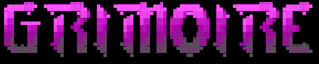

**Grimoire builds and maintains grimoires** — structured, AI-navigable knowledge bases the LLM keeps current.

Give your AI agent a map, not a maze.

## What Grimoire is

Grimoire is software you install once, next to an AI coding assistant such as Claude Code or Codex. It gives the assistant the commands, templates and checks it needs to build knowledge bases and keep them current. The documentation calls this software **the framework**, and each knowledge base **a grimoire**.

You install the framework at `~/.grimoire/`. Your grimoires live under `~/grimoires/`. Every grimoire uses the one installed framework, so an update to the framework reaches all of them.

## What a grimoire is

A grimoire is a knowledge base on one subject, for one person or for many: operations runbooks, a project's decisions, a set of recipes, a campaign's lore. It is a folder of Markdown pages in a git repository, which is how it is shared.

Three things make it different from a folder of notes:

- **The assistant finds the right page instead of searching.** Every folder has a hub, a page named after the folder that lists what the folder holds. The assistant starts at the root hub and follows hubs until it reaches the page that answers the question:

  ```
  "How long does sourdough proof?"
  cooking-grimoire.md -> recipes.md -> sourdough.md
  ```

- **The assistant does the upkeep.** You hand it a topic, a good answer from a chat, a document or a folder. It writes the pages, files the sources they cite, updates the hubs and checks the links.
- **A grimoire can carry its own commands.** A cooking grimoire can ship `/cook-meal-plan`; the command works from the pages the grimoire holds.

The [operating model](docs/operating_model.md) owns the structure: what each folder of a grimoire holds and how hubs route.

You work through commands typed into the assistant:

| You want to | Command |
|---|---|
| Join a grimoire you were given a link to, or start one | `/grm-setup` |
| Put knowledge in | `/grm-add` |
| Share your changes | `/grm-save` |
| Pick up everyone else's changes and stay current | `/grm-update` |
| Find what is broken or stale | `/grm-check` |

[Skills](docs/skills.md) lists every command.

## Install

You need an AI coding assistant that is installed and signed in, `git`, and Python 3.10 or newer.

**Claude Code.** Type these two lines in a Claude Code session, then start a new session:

```text
/plugin marketplace add justinlavi/grimoire
/plugin install grimoire@grimoire
```

**Codex, or any other assistant.** Run the installer in a terminal (Git Bash on Windows), then start a new session in the assistant:

```bash
curl -fsSL https://raw.githubusercontent.com/justinlavi/grimoire/main/rites/summon.sh | bash
```

**From a mirror.** Both routes above install from the public repository. A mirror is a copy of this repository kept somewhere else, such as a company's own git server. When you were given the address of a mirror, install from it; the install then takes its updates from the mirror too.

| Route | With a mirror |
|---|---|
| Claude Code | Give the mirror's address in the first line: `/plugin marketplace add <mirror address>` |
| The installer | Set `FRAMEWORK_URL`: `curl -fsSL https://raw.githubusercontent.com/justinlavi/grimoire/main/rites/summon.sh \| FRAMEWORK_URL=<mirror address> bash` |

Then type `/grm-setup` in the assistant. It joins an existing grimoire from its link, turns a folder of notes into one, or starts a new one. A Claude Code plugin install spells the command `/grimoire:setup`.

| You want | Read |
|---|---|
| Installing, setting up a grimoire and the everyday commands, step by step | [Getting started](docs/getting_started.md) |
| Every install route, the check that an install works, and troubleshooting | [Installation](docs/installation.md) |
| Which assistants Grimoire sets up by itself and which need a manual step | [Agent targets](docs/agent_targets.md) |

## Update

Type `/grm-update`. It brings the framework and every grimoire current.

When the commands are missing or behave wrongly, tell the assistant:

```text
Read ~/.grimoire/UPDATE.md and follow its AI Update Playbook exactly.
```

[UPDATE.md](UPDATE.md) owns that procedure.

## Documentation

**Using Grimoire**

| Page | What it holds |
|---|---|
| [Getting started](docs/getting_started.md) | Installing Grimoire, setting up a grimoire, and the everyday commands |
| [Installation](docs/installation.md) | Every install route, the smoke test, troubleshooting |
| [Update](UPDATE.md) | The update procedure an assistant follows when the installed commands cannot be trusted |
| [Skills](docs/skills.md) | Every command, with its description |
| [Operating model](docs/operating_model.md) | Storage layers, hub routing, naming and depth conventions |
| [Page schema](docs/page_schema.md) | The frontmatter every page carries |
| [Reference](docs/reference.md) | Vocabulary, the grimoire manifest, the library file, path keys |
| [Obsidian](docs/obsidian.md) | Opening a grimoire as an Obsidian vault |
| [VS Code](docs/vscode.md) | Wikilink setup in VS Code |
| [Changelog](CHANGELOG.md) | What each release changed |

**Maintaining the framework**

| Page | What it holds |
|---|---|
| [Contributing](CONTRIBUTING.md) | How to contribute |
| [Agent configuration](docs/agent_configuration.md) | Per-agent setup, plugin mode, how skills are registered |
| [Agent targets](docs/agent_targets.md) | Which agents are supported and how |
| [Summoning contract](docs/summoning_contract.md) | The installer's contract |
| [Skill schema](docs/skill_schema.md) | Command families, command naming, `SKILL.md` structure |
| [Command surface](docs/command_surface.md) | The public command contract |
| [Rite profiles](docs/rite_profiles.md) | The mutation profile of each rite that writes |
| [Script vs AI](docs/script_vs_ai.md) | When a rite does the work and when a playbook does |
| [Evals](docs/evals.md) | Tests that run a playbook with a model |
| [Governance](docs/governance.md) | Versioning, the compatibility rule, what belongs in the framework |
| [Writing standard](docs/writing_standard.md) | How documentation, playbooks, comments and replies are worded |
| [Release](docs/release.md) | Release steps |
| [Architecture backlog](docs/architecture_backlog.md) | Open architecture work and the decisions that still bind |
| [Grimoire hub](grimoire.md) | The root hub: routes to every page, invocation, formula and rite |
